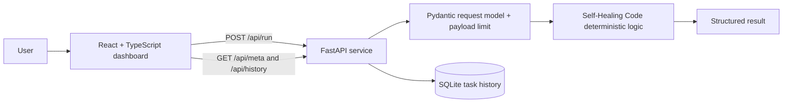

<div align="center">

# PlotXYZ.ai · Self-Healing Code

**Patch the obvious problems before they become incidents.**

[](https://github.com/sukhee-2626/plotxyz-self-healing-code-agent/actions/workflows/ci.yml)


</div>

> **PlotXYZ.ai Agents** — specialized intelligence. One connected workspace.

## 1. Project identity and purpose

**Self-Healing Code** is an original, independently runnable PlotXYZ.ai agent MVP. Parses Python source, finds common defects such as bare excepts, None equality, mutable defaults, and dynamic execution, and generates syntax-validated patches.

The project is a functional reference implementation, not a claim that PlotXYZ.ai owns or endorses any third-party technology. It runs without a paid API key: the deterministic implementation is the default path, and optional model providers are configured explicitly.

## 2. Problem statement and intended users

Teams often need a focused, inspectable tool rather than another general chatbot. This agent packages one clear workflow with structured inputs, deterministic checks, and an exportable result.

**Intended users:** Developers doing a fast pre-review pass on Python snippets.

## 3. Features

- **AST-based defect detection**
- **Syntax-validated safe patches**
- **Before/after patch preview**

- **Structured results:** metrics, findings, tables, charts, graphs, patches, or generated documents as appropriate.
- **Task history:** local SQLite persistence for completed runs.
- **Provider status:** the dashboard reports whether an optional model adapter is configured.
- **Accessible states:** loading, success, validation error, and offline-API states are explicit.

## 4. Screenshots

> **Screenshot placeholder:** run the app locally and add `docs/screenshot.png` here. No fabricated screenshot is included in this repository.

## 5. Architecture



The frontend is a Vite/React single-page dashboard. The backend validates the request, applies a 200,000-character payload limit, runs the agent-specific logic, stores a local history record, and returns a structured response. The logic layer is original Python and does not execute supplied code or shell commands.

## 6. Technology stack

| Layer | Technology |
| :-- | :-- |
| Frontend | React 18, TypeScript, Vite 5, Lucide icons, custom CSS design system |
| Backend | Python 3.11+, FastAPI, Pydantic 2 |
| Persistence | SQLite (local task history) |
| Tests | Pytest, FastAPI TestClient |
| CI | GitHub Actions (backend tests + frontend production build) |

## 7. Repository structure

```text
plotxyz-self-healing-code-agent/
├── backend/
│   ├── app/
│   │   ├── __init__.py
│   │   ├── logic.py          # original agent-specific logic
│   │   └── main.py           # FastAPI routes, validation, SQLite history
│   ├── tests/test_api.py
│   └── requirements.txt
├── frontend/
│   ├── src/
│   │   ├── App.tsx
│   │   ├── agentConfig.ts
│   │   ├── main.tsx
│   │   └── styles.css
│   ├── index.html
│   ├── package.json
│   ├── tsconfig.json
│   └── vite.config.ts
├── docs/
│   ├── ARCHITECTURE.md
│   └── API.md
├── .github/workflows/ci.yml
├── .env.example
├── CHANGELOG.md
├── CONTRIBUTING.md
├── LICENSE
├── SECURITY.md
└── README.md
```

## 8. Prerequisites

- Python 3.11 or newer
- Node.js 20 or newer and npm
- Git
- No paid API key is required

## 9. Installation and startup

```bash
git clone https://github.com/sukhee-2626/plotxyz-self-healing-code-agent.git
cd plotxyz-self-healing-code-agent
```

### Backend

```bash
python -m venv .venv
# Windows: .venv\Scripts\activate
# macOS/Linux: source .venv/bin/activate
pip install -r backend/requirements.txt
uvicorn app.main:app --reload --app-dir backend
```

The API is available at `http://localhost:8000`; interactive docs are at `/docs`.

### Frontend

```bash
cd frontend
npm install
npm run dev
```

Open `http://localhost:5173`. The frontend defaults to `http://localhost:8000` for the API. Set `VITE_API_BASE_URL` to point elsewhere.

### Production deployment

```bash
cd frontend
npm ci
npm run build
# Serve frontend/dist with any static host or reverse proxy.

cd ../backend
pip install -r requirements.txt
uvicorn app.main:app --host 0.0.0.0 --port 8000
```

Set `VITE_API_BASE_URL` at build time to the public API URL, and set `CORS_ORIGINS` to the deployed frontend origin. Persist `backend/data/` if task history matters. The app is otherwise stateless and does not require a paid API key.

## 10. Environment configuration

Copy `.env.example` to `.env` and export the values in your shell (the backend does not auto-load `.env`).

| Variable | Purpose | Required |
| :-- | :-- | :-- |
| `VITE_API_BASE_URL` | Frontend API base URL | No (defaults to `http://localhost:8000`) |
| `OPENAI_BASE_URL` | OpenAI-compatible API base | No |
| `OPENAI_API_KEY` | Provider key (never commit it) | No |
| `OPENAI_MODEL` | Model name for the optional adapter | No |
| `OLLAMA_BASE_URL` | Local Ollama-compatible base URL | No |
| `OLLAMA_MODEL` | Local model name | No |
| `CORS_ORIGINS` | Comma-separated allowed origins | No |
| `MAX_PAYLOAD_CHARS` | Server-side payload limit | No (default `200000`) |

The deterministic path is always available. When no provider is configured, the UI shows **Deterministic mode** and the API reports the provider status without exposing secrets.

## 11. API example

```bash
curl -X POST http://localhost:8000/api/run \
  -H "Content-Type: application/json" \
  -d '{"payload": {"code": "def load(path):\n    try:\n        return open(path).read()\n    except:\n        return None\n\nif load(\"x\") == None:\n    print(\"missing\")"}}'
```

Sample payload:

```json
{
  "code": "def load(path):\n    try:\n        return open(path).read()\n    except:\n        return None\n\nif load(\"x\") == None:\n    print(\"missing\")"
}
```

The response contains `summary`, `result` (structured metrics, findings, tables, charts, or documents), `warnings`, `agent`, and `task_id`. See [`docs/API.md`](docs/API.md) for the full contract.

## 12. Testing

```bash
cd backend
python -m pytest -q

cd ../frontend
npm run build
```

The backend suite covers the sample workflow, empty-input rejection, health/meta endpoints, the run endpoint, history persistence, and HTTP 422 validation. CI runs both jobs on every push and pull request.

## 13. Security and privacy considerations

- No endpoint exposes arbitrary shell execution or unrestricted filesystem access.
- The agent never executes supplied code, downloads files, or writes to user-selected paths.
- Inputs are size-limited; errors are structured and do not leak secrets.
- Secrets are read from environment variables and are never returned by the API.
- Optional model calls go only to explicitly configured environment endpoints; user-supplied URLs are not fetched.
- SQLite history is local to the backend and can be cleared from the dashboard.
- See [`SECURITY.md`](SECURITY.md) for reporting guidance.

## 14. Limitations

- Pattern-based fixes require human review.
- The agent never executes the supplied code.

- The deterministic logic is intentionally scoped; optional AI inference may improve flexibility but is not required or guaranteed.
- Results are decision support, not professional advice. Review outputs before acting on them.

## 15. Roadmap

- [ ] Expand ast-based defect detection with configurable policies.
- [ ] Add deployment manifests, structured audit logs, and load tests.
- [ ] Add more export formats and team-oriented workspaces.

## 16. Contribution guidelines

Contributions are welcome. Read [`CONTRIBUTING.md`](CONTRIBUTING.md) for setup, test, and pull-request guidance. Please keep changes focused, add tests for behavior changes, and do not commit secrets.

## 17. License

MIT License. Copyright (c) 2026 sukhee-2626. See [`LICENSE`](LICENSE).

The license choice covers this repository's original source code. Third-party dependencies remain under their own licenses.
