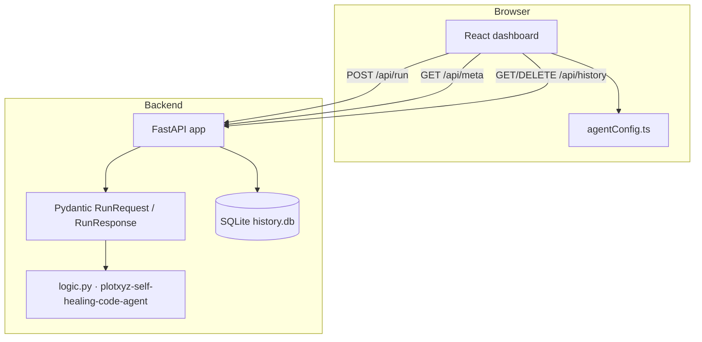

# Architecture · Self-Healing Code

## Overview

Parses Python source, finds common defects such as bare excepts, None equality, mutable defaults, and dynamic execution, and generates syntax-validated patches.

This repository is independently runnable. It contains its own React dashboard, FastAPI service, deterministic agent logic, SQLite history, tests, and documentation. It does not import code from another agent repository.

## Components

## Request lifecycle

1. The dashboard builds a typed payload from the agent-specific form.
2. `POST /api/run` validates the envelope with Pydantic and enforces the payload character limit.
3. `logic.run(payload)` validates fields, performs deterministic analysis, and returns `summary`, `result`, and `warnings`.
4. The API writes a local history row and returns a structured `RunResponse`.
5. The dashboard renders metrics, findings, tables, charts, graphs, patches, or documents and offers copy/export actions.

## Design decisions

- **Deterministic first.** Every feature works without a paid key. Optional provider adapters are opt-in and report their status.
- **Original, scoped logic.** The agent-specific implementation lives in `backend/app/logic.py`; it does not call a shared chatbot endpoint.
- **No unsafe execution.** Supplied code and data are parsed or analyzed, never executed as shell commands. Workflow operations are allowlisted and in-memory.
- **Local persistence.** SQLite keeps the demo self-contained; the history endpoint is bounded and can be cleared.
- **Single design language, agent-specific content.** The UI shell is shared scaffolding; forms, examples, accent, results, and backend behavior are specific to this agent.

## Error handling

| Condition | Behavior |
| :-- | :-- |
| Missing or invalid field | `422` with a specific validation message |
| Payload over limit | `413` |
| Unexpected logic failure | `500`, logged server-side without secrets |
| API offline | Dashboard shows an actionable error and keeps the form intact |
| Optional provider unavailable | Deterministic fallback with a visible warning |

## Security and privacy

- No shell, unrestricted filesystem, or arbitrary URL execution is exposed.
- Secrets come from environment variables and are never included in responses.
- CORS is restricted to configured local origins by default.
- History is local and bounded; users can delete it.
- The agent analyzes supplied content only and does not claim external verification.

## Testing strategy

- Unit-level sample execution and agent-specific assertions.
- API integration tests for health, meta, run, history, and validation.
- Frontend production build in CI.

## Limits

- The backend is a single-process reference service; SQLite is not intended for multi-tenant scale.
- No authentication or rate limiting is included in this MVP; add them before exposing the service publicly.
